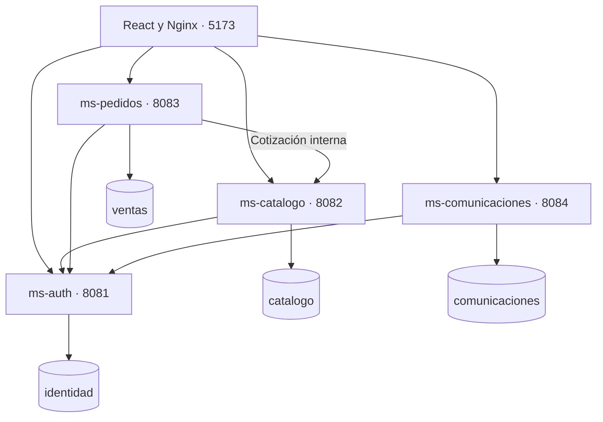

# Jarodandre · Backend local con MySQL

Backend de JA Joyería con cuatro microservicios Java 21 y Spring Boot 3.5.16. Docker Compose levanta MySQL 8.4, los servicios y el frontend React publicado por Nginx. La configuración actual está orientada al desarrollo local con pagos simulados.

## Arquitectura y responsabilidades



Las cuatro bases pertenecen a una misma instancia MySQL. Cada servicio administra sus tablas y migraciones. Los datos de otros dominios se consultan mediante HTTP. Los pedidos guardan una copia de los artículos y precios comprados para conservar su historial.

| Servicio | Dominio y tablas | Documentación |
| --- | --- | --- |
| `ms-auth` | Usuarios, contraseñas, JWT RSA, roles y territorios. Base `identidad`, con `usuarios`, `regiones` y `comunas`. | [Auth](./ms-auth/README.md) |
| `ms-catalogo` | Productos, categorías, disponibilidad, imágenes y artículos. Base `catalogo`, con `productos`, `categorias` y `publicaciones`. | [Catálogo](./ms-catalogo/README.md) |
| `ms-pedidos` | Carritos, checkout, pagos, despacho y reportes. Base `ventas`, con `carritos`, `carrito_items`, `pedidos`, `pedido_items`, `intentos_pago` y `accesos_invitado`. | [Pedidos](./ms-pedidos/README.md) |
| `ms-comunicaciones` | Contacto y newsletter. Base `comunicaciones`, con `mensajes_contacto` y `suscripciones`. | [Comunicaciones](./ms-comunicaciones/README.md) |

Todos usan Spring Web, Validation, Spring Data JPA, Spring Security, Lombok, DTO como `record`, Liquibase y Swagger/OpenAPI. Los paquetes `controller`, `service`, `repository`, `entity`, `dto` y `config` mantienen la misma organización en los cuatro proyectos.

## Requisitos y clonación

Para Docker se requiere Docker Desktop con motor Linux y Docker Compose v2. Para ejecutar Java y Vite directamente se requieren además JDK 21, Node.js 24 y npm. Cada microservicio incluye Maven Wrapper.

```powershell
git clone https://github.com/pablophdev/ja-joyeria.git
git clone https://github.com/pablophdev/jarodandre-backend.git
cd jarodandre-backend
```

Los repositorios deben quedar como carpetas hermanas, porque Compose construye el frontend desde `../ja-joyeria/jarodandre`.

```text
carpeta-de-trabajo/
├── ja-joyeria/jarodandre/
│   ├── Dockerfile
│   └── nginx.conf
└── jarodandre-backend/
    ├── docker-compose.yml
    ├── docker/mysql/init.sql
    ├── ms-auth/Dockerfile
    ├── ms-catalogo/Dockerfile
    ├── ms-pedidos/Dockerfile
    └── ms-comunicaciones/Dockerfile
```

## Arranque con Docker Compose

```powershell
docker compose up -d --build
docker compose ps
```

El primer arranque descarga las imágenes y compila las aplicaciones. El contenedor MySQL ejecuta `docker/mysql/init.sql` sobre un volumen vacío. Después Liquibase crea las tablas de cada dominio. La carga inicial incluye 3 regiones, 11 comunas, 4 categorías, 14 productos y 9 publicaciones.

Compose espera a MySQL antes de iniciar los servicios. Catálogo y comunicaciones esperan a auth; pedidos también espera a catálogo. El frontend inicia cuando sus APIs están saludables. Los healthchecks de las APIs usan `/v3/api-docs`, por lo que Compose habilita Swagger con `SWAGGER_ENABLED=true`.

| Recurso | Acceso desde el equipo |
| --- | --- |
| Tienda | [http://localhost:5173](http://localhost:5173) |
| Auth | [Swagger 8081](http://localhost:8081/swagger-ui/index.html) |
| Catálogo | [Swagger 8082](http://localhost:8082/swagger-ui/index.html) |
| Pedidos | [Swagger 8083](http://localhost:8083/swagger-ui/index.html) |
| Comunicaciones | [Swagger 8084](http://localhost:8084/swagger-ui/index.html) |
| MySQL | `127.0.0.1:3307` |

Los puertos publicados se limitan a `127.0.0.1`. Entre contenedores se usan los nombres `mysql`, `ms-auth`, `ms-catalogo`, `ms-pedidos` y `ms-comunicaciones`. MySQL escucha en `3306` dentro de esa red; `3307` es su puerto en el equipo.

Nginx sirve React y reenvía `/api/auth/`, `/api/catalogo/`, `/api/pedidos/` y `/api/comunicaciones/` al servicio correspondiente, retirando el prefijo. La autenticación y los permisos se comprueban en las APIs.

## Credenciales locales

| Cuenta | Usuario | Contraseña |
| --- | --- | --- |
| Administrador de la tienda | `admin@jarodandre.local` | `Admin123123` |
| Aplicación MySQL | `ja` | `123123` |
| Administración MySQL | `root` | `123123` |

Estas cuentas y secretos están definidos para desarrollo local. Compose activa `LOCAL_ADMIN_ENABLED=true`. Auth crea el administrador con RUT `11111111-1` y comuna `1` cuando ese correo aún no existe. Reiniciar el servicio conserva la cuenta y su contraseña.

El usuario `ja` tiene permisos sobre las cuatro bases para simplificar el arranque local. La separación de usuarios SQL por servicio, el almacenamiento de secretos y la configuración de HTTPS corresponden a la preparación de producción.

## Configuración de las APIs

`application.properties` contiene la configuración compartida y activa `mysql` como perfil predeterminado. `application-mysql.properties` define la conexión y las direcciones de otros servicios. Hibernate valida el esquema creado por Liquibase.

| Variable | Uso y valor local |
| --- | --- |
| `SPRING_PROFILES_ACTIVE` | `mysql`. |
| `DB_URL` | JDBC de la base propia. Fuera de Docker usa `localhost:3307`; dentro usa `mysql:3306`. |
| `DB_USERNAME`, `DB_PASSWORD` | `ja`, `123123`. |
| `DB_POOL_SIZE` | Máximo de conexiones por servicio, por defecto `4`. |
| `PORT` | `8081`, `8082`, `8083` o `8084`, según el servicio. |
| `FRONTEND_ORIGIN` | `http://localhost:5173`. |
| `SWAGGER_ENABLED` | Activa UI y documento OpenAPI. Predeterminado `false`, habilitado en Compose. |
| `MS_AUTH_URL` | URL base de auth para catálogo, pedidos y comunicaciones. |
| `MS_CATALOGO_URL` | URL base de catálogo para pedidos. |
| `CATALOGO_INTERNAL_TOKEN` | Secreto compartido por catálogo y pedidos, enviado como `X-Internal-Token`. |
| `PAGO_SIMULADO` | Habilita el simulador de pedidos; Compose usa `true`. |
| `LOCAL_ADMIN_ENABLED` | Habilita la creación inicial del administrador. Predeterminado `false`. |
| `MEDIA_STORAGE` | `local` por defecto. La implementación de S3 se selecciona con `s3`. |
| `MEDIA_BUCKET`, `AWS_REGION` | Bucket y región al usar S3. |
| `MYSQL_PORT` | Puerto de MySQL publicado por Compose, por defecto `3307`. |

Ejemplo de URL JDBC para auth fuera de Docker:

```properties
DB_URL=jdbc:mysql://localhost:3307/identidad?useSSL=false&allowPublicKeyRetrieval=true&connectionTimeZone=UTC
```

Para personalizar el administrador se admiten las propiedades `app.local-admin.correo` y `app.local-admin.password`. Auth lee el par RSA desde `app.jwt.private-key` y `app.jwt.public-key`, cuyos valores locales son `file:./data/keys/private.pem` y `file:./data/keys/public.pem`. Si ambos archivos faltan y `app.jwt.generate-local-keys=true`, genera el par al arrancar.

## Ejecutar Java y Vite directamente

Iniciar solo la base desde la raíz del backend:

```powershell
docker compose up -d mysql
```

Abrir una terminal por servicio. Iniciar auth primero:

```powershell
cd ms-auth
$env:LOCAL_ADMIN_ENABLED='true'
.\mvnw.cmd spring-boot:run
```

En la terminal de catálogo:

```powershell
cd ms-catalogo
$env:CATALOGO_INTERNAL_TOKEN='local-jarodandre-interno-2026'
.\mvnw.cmd spring-boot:run
```

En la terminal de pedidos usar el mismo token:

```powershell
cd ms-pedidos
$env:CATALOGO_INTERNAL_TOKEN='local-jarodandre-interno-2026'
$env:PAGO_SIMULADO='true'
.\mvnw.cmd spring-boot:run
```

En la terminal de comunicaciones:

```powershell
cd ms-comunicaciones
.\mvnw.cmd spring-boot:run
```

Cada `cd` parte de una terminal situada en la raíz del backend. Las URLs predeterminadas entre servicios usan `localhost:8081` y `localhost:8082`. Para habilitar Swagger al ejecutar Java directamente, definir `$env:SWAGGER_ENABLED='true'` en cada terminal. Finalmente, en `ja-joyeria/jarodandre`, ejecutar `npm ci` y `npm run dev -- --port 5173 --strictPort`.

## Autenticación y permisos

Auth registra contraseñas con BCrypt y emite JWT firmados con RSA. Registro y login devuelven `accessToken`, `expiresIn` y `usuario`. Los servicios verifican firma, emisor, audiencia, vigencia, tipo de token y sujeto. La clave pública se publica en `GET /v1/auth/jwks`.

Los roles son `CLIENTE`, `EMPLEADO` y `ADMIN`, y los estados `PENDIENTE`, `ACTIVO` y `BLOQUEADO`. El registro público asigna `CLIENTE` y `ACTIVO`. Las operaciones administrativas requieren `ADMIN` activo. Catálogo, pedidos y comunicaciones consultan `GET /v1/me` de auth para comprobar el perfil y sus permisos de negocio.

Pedidos usa sesiones privadas para invitados. Los tokens se almacenan como hashes en la base. El token del carrito permite editarlo y resolver su checkout; el token de consulta concede acceso a una orden concreta durante 30 días. La vinculación requiere sesión activa, el token de consulta y un correo coincidente con el del pedido; revoca ese acceso invitado. La autenticación local actual registra correos sin un flujo de verificación por email.

## Compra y consistencia

El servidor cotiza productos antes de confirmar y compara el total con el mostrado al comprador. `DISPONIBLE` y `CONSULTAR` permiten comprar en la demo; `AGOTADO` y los productos retirados bloquean el checkout. El inventario usa disponibilidad declarada.

`Idempotency-Key` identifica un checkout dentro de su carrito. Repetir la clave y los mismos datos recupera la misma orden. Mientras haya un pedido pendiente, el carrito exige resolverlo antes de editar sus líneas. Confirmar el pago simulado registra el pago y vacía el carrito; cancelarlo conserva los artículos. Los bloqueos de fila y las transacciones coordinan esas operaciones.

Los estados de pago son `PENDIENTE`, `PAGADO` y `FALLIDO`. La entrega avanza de `PENDIENTE` a `ENVIADO` y después `COMPLETADO`, con pago aprobado. El comprobante `BOL-...` representa internamente una compra pagada. Una pasarela real y la emisión tributaria requieren integraciones posteriores.

## Datos, migraciones y volúmenes

Liquibase ejecuta los changesets de `src/main/resources/db/changelog` en cada servicio y mantiene sus tablas de seguimiento en la base correspondiente. Las migraciones usan tipos MySQL, UUID binarios y campos JSON para etiquetas y párrafos. Los importes CLP son enteros y las fechas se manejan en UTC.

Agregar nuevos changesets para futuras evoluciones. Auth y comunicaciones aceptan también el checksum concreto de una versión intermedia de la migración local inicial, para conservar el historial existente. Una instalación PostgreSQL anterior requiere exportar y transformar los datos hacia las nuevas bases MySQL.

| Volumen de Compose | Contenido |
| --- | --- |
| `mysql-data` | Bases y registros de Liquibase. |
| `auth-keys` | Par RSA de auth. |
| `catalogo-imagenes` | Fotografías subidas al almacenamiento local. |

`docker compose down` conserva los volúmenes. La opción `--volumes` los elimina junto con sus datos. El script `docker/mysql/init.sql` solo se aplica al inicializar un volumen vacío. Las imágenes iniciales del catálogo y blog están incluidas como recursos del JAR; las nuevas usan el almacenamiento seleccionado.

## Operación y comprobaciones

```powershell
docker compose config --quiet
docker compose ps
docker compose logs --tail=100 ms-auth
docker compose logs --tail=100 ms-pedidos
docker compose restart ms-pedidos
docker compose down
```

Después de modificar código, reconstruir con `docker compose up -d --build`. Para comprobar consultas públicas abrir `/v1/regiones` en auth, `/v1/productos` y `/v1/publicaciones` en catálogo. Swagger documenta los DTO, headers y operaciones de cada servicio.

Dentro de cada microservicio:

```powershell
.\mvnw.cmd clean verify
```

Las pruebas de integración usan MySQL efímero con Testcontainers y requieren acceso al motor Docker. Cuando el motor no está disponible se omiten las suites que así lo declaran. Las imágenes de desarrollo se construyen con `-DskipTests`; la compilación de la imagen y la ejecución de pruebas son comprobaciones distintas.

## Diagnóstico

| Situación | Comprobación |
| --- | --- |
| Puerto MySQL ocupado | Compose usa `3307`. Si hace falta otro, definir `MYSQL_PORT` y ajustar las URLs JDBC al ejecutar Java directamente. |
| Error de conexión a la base | Verificar credenciales, nombre de la base y hostname. Dentro de Docker usar `mysql`, y desde el equipo `localhost`. |
| Pedido devuelve error al cotizar | Comprobar que catálogo responde y que ambos servicios comparten `CATALOGO_INTERNAL_TOKEN`. |
| Checkout devuelve `503` | Revisar `PAGO_SIMULADO`; la pasarela real sigue pendiente. |
| Operación privada devuelve `401` o `403` | Revisar JWT, estado de cuenta, rol y disponibilidad de auth. |
| Frontend bloqueado por CORS | Abrir `http://localhost:5173` y comprobar `FRONTEND_ORIGIN`. |
| Servicio `unhealthy` | Leer sus logs. En Compose, los healthchecks requieren Swagger habilitado. |
| Liquibase rechaza un checksum | Comparar la versión aplicada con el historial del proyecto antes de cambiar una migración existente. |

## Producción

El objetivo posterior es ejecutar cada microservicio en una EC2 y utilizar Amazon API Gateway como entrada de las APIs. La implementación de este repositorio y su Compose corresponden al entorno local. El despliegue de producción deberá definir HTTPS, red privada, credenciales de base por servicio, gestión de secretos, persistencia externa de imágenes y la pasarela de pago.
