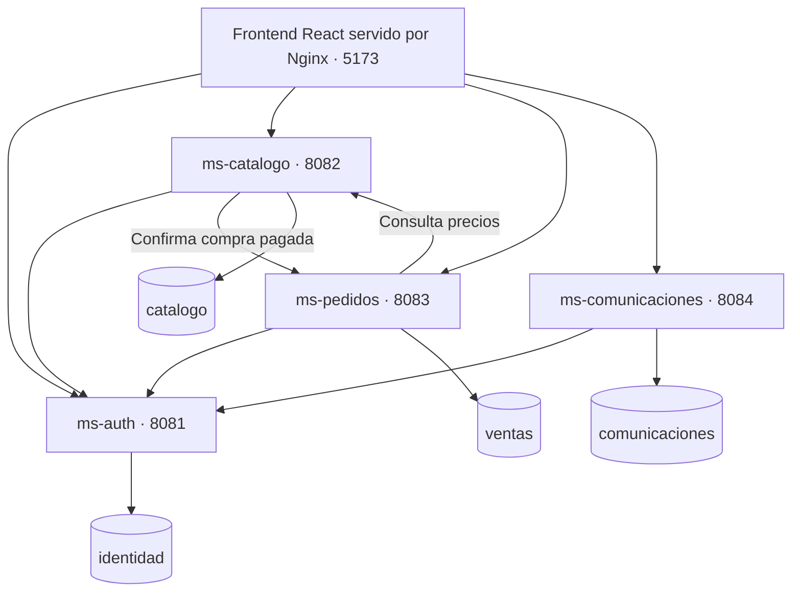

# Jarodandre: backend y guía para ejecutarlo

Este repositorio contiene el backend de JA Joyería y los archivos para iniciar la tienda completa en tu computador. Con Docker Compose puedes levantar MySQL, los cuatro servicios y la página web con un solo comando. Los pagos están simulados para desarrollo.

## Cómo se organiza

La aplicación está dividida en servicios pequeños. Cada uno se ocupa de una parte de la tienda y guarda sus datos en su propia base MySQL. Los servicios se comunican entre sí cuando necesitan información de otra área.



| Servicio | Para qué sirve | Base de datos |
| --- | --- | --- |
| `ms-auth` | Registro, inicio de sesión, cuentas, roles y comunas. | `identidad`: `usuarios`, `regiones`, `comunas`. |
| `ms-catalogo` | Productos, categorías, imágenes, artículos y reseñas. | `catalogo`: `productos`, `categorias`, `publicaciones`, `resenas`. |
| `ms-pedidos` | Carrito, compra, pago de prueba, despacho y reportes. | `ventas`: `carritos`, `carrito_items`, `pedidos`, `pedido_items`, `intentos_pago`, `accesos_invitado`. |
| `ms-comunicaciones` | Mensajes del formulario de contacto y suscripciones al boletín. | `comunicaciones`: `mensajes_contacto`, `suscripciones`. |

Las cuatro bases están dentro de la misma instancia de MySQL, pero cada servicio es responsable de sus propias tablas. Por ejemplo, catálogo no lee las tablas de pedidos: consulta al servicio de pedidos para comprobar si una compra fue pagada.

Los proyectos usan Java 21, Spring Boot, Spring Security, JPA y Liquibase. Liquibase prepara y actualiza las tablas al iniciar cada servicio. Swagger muestra la documentación de cada API.

## Requisitos

Para iniciar todo con Docker necesitas Docker Desktop con el motor Linux encendido y Docker Compose v2. Para ejecutar los proyectos directamente también necesitas JDK 21, Node.js 24 y npm. Cada servicio Java incluye Maven Wrapper.

## Descargar los repositorios

Clona ambos proyectos dentro de la misma carpeta, uno al lado del otro:

```powershell
git clone https://github.com/pablophdev/ja-joyeria.git
git clone https://github.com/pablophdev/jarodandre-backend.git
cd jarodandre-backend
```

Compose busca el frontend en `../ja-joyeria/jarodandre`, por eso es importante que las carpetas queden así:

```text
carpeta-de-trabajo/
├── ja-joyeria/
│   └── jarodandre/
└── jarodandre-backend/
    └── docker-compose.yml
```

## Iniciar la tienda con Docker

Desde la carpeta `jarodandre-backend`, ejecuta:

```powershell
docker compose up -d --build
docker compose ps
```

La primera vez Docker descarga las imágenes y compila las aplicaciones. Después MySQL crea las cuatro bases y Liquibase prepara sus tablas. La carga inicial incluye 3 regiones, 11 comunas, 4 categorías, 14 productos y 9 artículos.

Espera a que MySQL y los cuatro servicios aparezcan como `Healthy`. El frontend debe aparecer como `Started`. Luego abre la tienda en [http://localhost:5173](http://localhost:5173).

| Qué quieres abrir | Dirección |
| --- | --- |
| Tienda | [http://localhost:5173](http://localhost:5173) |
| Swagger de autenticación | [http://localhost:8081/swagger-ui/index.html](http://localhost:8081/swagger-ui/index.html) |
| Swagger del catálogo | [http://localhost:8082/swagger-ui/index.html](http://localhost:8082/swagger-ui/index.html) |
| Swagger de pedidos | [http://localhost:8083/swagger-ui/index.html](http://localhost:8083/swagger-ui/index.html) |
| Swagger de comunicaciones | [http://localhost:8084/swagger-ui/index.html](http://localhost:8084/swagger-ui/index.html) |
| MySQL desde tu computador | `127.0.0.1:3307` |

Nginx entrega la página web y dirige sus solicitudes al microservicio que corresponda. Los permisos y la validación de cada operación se controlan en las APIs.

## Cuentas de desarrollo

| Cuenta | Usuario | Contraseña |
| --- | --- | --- |
| Administrador de la tienda | `admin@jarodandre.local` | `Admin123123` |
| Usuario de la aplicación MySQL | `ja` | `123123` |
| Administrador de MySQL | `root` | `123123` |

Son credenciales locales para desarrollo. Auth crea la cuenta de administrador si todavía no existe. Los datos y la sesión de MySQL se conservan al apagar Compose normalmente.

## Reseñas y contacto

El administrador crea productos y selecciona una categoría existente. Las estrellas y la cantidad de reseñas no se editan desde administración: se calculan a partir de las valoraciones de clientes.

Una persona debe iniciar sesión y haber pagado por el producto para publicar una reseña. Puede actualizar su propia reseña más adelante. Catálogo verifica la cuenta con auth y la compra con pedidos.

Las reseñas se guardan en `catalogo.resenas`. Los mensajes que envían desde el formulario de contacto están en `comunicaciones.mensajes_contacto`. Quienes dejan su correo para recibir novedades se guardan en `comunicaciones.suscripciones`.

La migración que crea las reseñas pone en cero los antiguos contadores de estrellas, porque eran valores de demostración y no provenían de compras verificadas. A partir de entonces, el sistema calcula el resumen con reseñas reales. El promedio se redondea a un número entero para mostrarlo en las tarjetas.

Para revisar reseñas, catálogo ofrece `GET /v1/productos/{id}/resenas`. Para crear o actualizar una, usa `PUT /v1/productos/{id}/resenas` con un token de sesión y un cuerpo como este:

```json
{"estrellas": 5, "comentario": "Mi opinión sobre el producto"}
```

La solicitud debe corresponder a una compra pagada de esa cuenta. Los formularios con errores responden indicando en español qué dato revisar. La contraseña de registro debe tener entre 8 y 72 caracteres; el teléfono es opcional.

## Ejecutar sin contenedores para las aplicaciones

Puedes usar Docker solo para MySQL y arrancar cada programa desde su carpeta. Primero, desde la raíz del backend:

```powershell
docker compose up -d mysql
```

Abre una terminal por cada servicio. Inicia auth primero:

```powershell
cd ms-auth
$env:LOCAL_ADMIN_ENABLED='true'
.\mvnw.cmd spring-boot:run
```

En una segunda terminal, inicia catálogo:

```powershell
cd ms-catalogo
$env:CATALOGO_INTERNAL_TOKEN='local-jarodandre-interno-2026'
.\mvnw.cmd spring-boot:run
```

Inicia pedidos con el mismo valor para `CATALOGO_INTERNAL_TOKEN`:

```powershell
cd ms-pedidos
$env:CATALOGO_INTERNAL_TOKEN='local-jarodandre-interno-2026'
$env:PAGO_SIMULADO='true'
.\mvnw.cmd spring-boot:run
```

Y luego comunicaciones:

```powershell
cd ms-comunicaciones
.\mvnw.cmd spring-boot:run
```

Cada terminal debe comenzar en la carpeta raíz del backend antes de ejecutar su `cd`. Para ver Swagger cuando arrancas así, establece `$env:SWAGGER_ENABLED='true'` en cada terminal. Por último, en `ja-joyeria/jarodandre`, ejecuta `npm ci` y `npm run dev -- --port 5173 --strictPort`.

## Configuración

Los valores normales de desarrollo ya están definidos. Estas son las opciones más usadas si necesitas cambiar algo:

| Variable | Para qué sirve |
| --- | --- |
| `DB_URL` | Dirección JDBC de la base del servicio. En Docker, MySQL está en `mysql:3306`; desde tu computador, en `localhost:3307`. |
| `DB_USERNAME`, `DB_PASSWORD` | Usuario y contraseña de MySQL. En local son `ja` y `123123`. |
| `PORT` | Puerto del servicio: 8081, 8082, 8083 o 8084. |
| `FRONTEND_ORIGIN` | Dirección del frontend permitida por CORS. En local: `http://localhost:5173`. |
| `SWAGGER_ENABLED` | Muestra u oculta la documentación de Swagger. |
| `MS_AUTH_URL`, `MS_CATALOGO_URL`, `MS_PEDIDOS_URL` | Direcciones que los servicios usan para comunicarse entre sí. |
| `CATALOGO_INTERNAL_TOKEN` | Clave compartida para las solicitudes internas entre catálogo y pedidos. |
| `PAGO_SIMULADO` | Activa el pago de prueba. Compose lo deja activado. |
| `LOCAL_ADMIN_ENABLED` | Permite crear el administrador de desarrollo al iniciar auth. |
| `MYSQL_PORT` | Cambia el puerto de MySQL expuesto en el computador. Por defecto es `3307`. |
| `MEDIA_STORAGE`, `MEDIA_BUCKET`, `AWS_REGION` | Configuración del almacenamiento de imágenes. Por defecto se usa almacenamiento local. |

Las contraseñas, la clave privada de autenticación y el token interno son para desarrollo. Antes de desplegar en producción hay que reemplazarlos por valores privados y configurar la red y HTTPS.

## Datos y migraciones

Cada servicio tiene sus migraciones en `src/main/resources/db/changelog`. Al arrancar, Liquibase aplica las nuevas migraciones y conserva un registro de las ya ejecutadas. Para ampliar la base, agrega una nueva migración en vez de editar una que ya se haya aplicado.

| Volumen Docker | Qué conserva |
| --- | --- |
| `mysql-data` | Las bases y los datos. |
| `auth-keys` | Las claves usadas por autenticación. |
| `catalogo-imagenes` | Las imágenes cargadas en catálogo. |

`docker compose down` detiene la tienda y conserva estos datos. `docker compose down --volumes` también borra los volúmenes y su contenido. El archivo de inicialización de MySQL se aplica únicamente cuando se crea un volumen vacío.

## Comandos útiles

```powershell
docker compose ps
docker compose logs --tail=100 ms-auth
docker compose logs --tail=100 ms-pedidos
docker compose restart ms-pedidos
docker compose up -d --build
docker compose down
```

Después de cambiar código, vuelve a construir con `docker compose up -d --build`. Si un servicio no inicia, mira sus registros con `docker compose logs --tail=100 nombre-del-servicio`.

Para una revisión completa de un servicio Java, desde su carpeta puedes ejecutar:

```powershell
.\mvnw.cmd clean verify
```

Las pruebas de integración usan Docker para preparar MySQL temporal. Las imágenes normales de Compose se construyen sin ejecutar esas pruebas; construir una imagen y correr las pruebas son pasos distintos.

## Problemas comunes

| Qué ocurre | Qué revisar |
| --- | --- |
| MySQL no puede usar el puerto | El puerto local predeterminado es `3307`. Puedes cambiarlo con `MYSQL_PORT`. |
| Un servicio no se conecta a MySQL | Revisa el nombre de base, usuario y contraseña. Entre contenedores el servidor se llama `mysql`; desde Windows usa `localhost`. |
| No se puede completar una compra | Mira los registros de `ms-pedidos`, `ms-catalogo` y MySQL. Confirma que ambos servicios compartan `CATALOGO_INTERNAL_TOKEN`. |
| Una API dice `401` o `403` | Revisa si iniciaste sesión, el rol de la cuenta y si auth está funcionando. |
| El navegador bloquea una solicitud | Usa `http://localhost:5173` y revisa `FRONTEND_ORIGIN`. |
| Un servicio aparece como `unhealthy` | Consulta sus registros. En Compose, Swagger debe estar habilitado para el chequeo de estado. |
| Liquibase muestra un checksum distinto | Comprueba qué versión de la migración se aplicó antes de hacer cambios en una migración existente. |

## Más adelante: producción

La arquitectura planeada contempla el frontend y cada microservicio en AWS, con Amazon API Gateway como entrada para las APIs. Este Compose está hecho para desarrollo local. Antes de producción habrá que preparar HTTPS, secretos privados, una base protegida, almacenamiento externo de imágenes y un proveedor de pagos real.

## Personalizador de grillz 3D

`ms-catalogo` administra los acabados, las tarifas de referencia, los diseños guardados y las solicitudes de cotización. La migración `004-grillz.sql` agrega `catalogo.opciones_grillz` y `catalogo.disenos_grillz`, sin modificar las migraciones anteriores.

Cada diseño guarda al propietario, el nombre, el modelo versionado (`arcada-v1`), la configuración por diente, el estimado del servidor y el estado `BORRADOR` o `SOLICITADO`. Una cuenta solo puede consultar y enviar sus propios diseños; la bandeja de solicitudes requiere administrador activo. Auth comprueba el estado de la cuenta.

| Operación | Ruta en catálogo | Acceso |
| --- | --- | --- |
| Consultar acabados y tarifas | `GET /v1/grillz/opciones` | Público |
| Obtener un estimado | `POST /v1/grillz/estimacion` | Público |
| Guardar un diseño | `POST /v1/grillz/disenos` | Cuenta activa |
| Recuperar mis diseños | `GET /v1/grillz/disenos?pagina=0` | Cuenta activa |
| Solicitar cotización de un diseño | `POST /v1/grillz/disenos/{id}/cotizacion` | Propietario |
| Ver solicitudes | `GET /v1/admin/grillz/cotizaciones?pagina=0` | Administrador |

Ejemplo para guardar o calcular un diseño:

```json
{
  "nombre": "Mi diseño",
  "modelo": "arcada-v1",
  "dientes": [
    { "id": "S4", "material": "dorado", "estilo": "piedras" },
    { "id": "I4", "material": "plata", "estilo": "liso" }
  ]
}
```

Los dientes válidos son `S1` a `S8` e `I1` a `I8`, de izquierda a derecha en la vista frontal. El servidor rechaza repeticiones y opciones inexistentes, asigna al propietario desde la sesión y calcula el precio usando `opciones_grillz`; no acepta un precio enviado por el navegador. Las tarifas iniciales por diente son: dorado $35.000, plateado $25.000 y oro rosado $38.000; piedras agrega $18.000. Son referencias para desarrollo, pendientes de definir comercialmente.

La solicitud conserva el diseño y el estimado guardados. Repetir el envío del mismo diseño no duplica la solicitud. La revisión del presupuesto y el ajuste son manuales; este flujo no crea un pedido ni cobra un pago. La descarga JPG se genera en el navegador y no necesita almacenar imágenes en la base.
